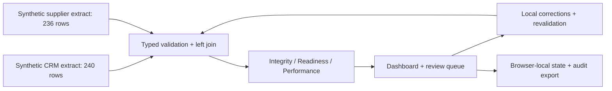
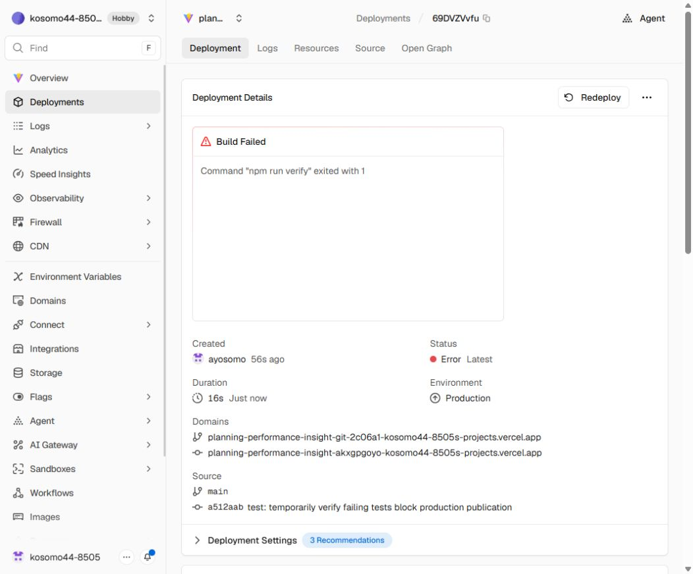

# Planning & Performance Insight Lab

[](https://github.com/ayosomo/Planning-Performance-Insight-Lab/actions/workflows/ci.yml)

A synthetic portfolio demonstration by Olukoyede Osomo. Consolidate two source extracts, inspect data-integrity failures, distinguish operational blockers from delivery risks, and complete an accountable reviewer workflow.

[Open the live demonstration](https://planning-performance-insight-lab.vercel.app/)

Validated with 47 automated tests, 10 end-to-end browser checks and eight rendered accessibility states. All operational data is fictional.


## Run locally

Requires Node.js 22.12+ (tested on Node 24) and npm.

```sh
npm install
npm run dev
npm test
npm run build
npm run qa
npm run verify
npm run test:workflow
```

Open the localhost URL printed by the server. **`npm run dev` builds the client and Nitro server, then serves both locally on port 5173**. Re-run it after source edits. `npm run dev:vite` offers conventional Vite hot reload when workstation memory permits. `npm run preview` serves the existing full-stack build. A lockfile records installed versions. The tool launcher bounds native compiler concurrency.

## What to explore

- **Overview:** independent integrity, readiness and delivery indicators, population filters, trusted-row exclusions, forecast adherence and the original workbook comparison.
- **Exception review:** search, filter, sort, inspect every source match, assign a reviewer, record evidence, correct a local source, revalidate, resolve and reopen.
- **Source lineage:** source-to-KPI path, join assumptions, row counts, missing and ambiguous joins.
- **Metric dictionary:** calculations, controls, decisions, limitations and cadence.
- **Portfolio evidence:** historical Project Lite experience separated from this fictional implementation.

The snapshot is fixed at **23 October 2026**. Human-action audit timestamps use the actual action time. No actual completion dates were supplied, so actual on-time performance is explicitly unavailable. Forecast adherence is separately labelled.

## Data and parity

The committed fixture preserves **240 CRM rows / 236 supplier rows / 35 fictional accounts** extracted from the supplied workbook. Original Excel combined controls reproduce **208 PASS / 32 REVIEW**, 69 overdue rows and 92 escalation rows. The new integrity-only definition independently yields **228 passing / 12 failing** rows. These are different definitions, not conflicting historical results.

See [the reconciliation](docs/workbook-parity.md), [metrics](docs/metrics.md), [lineage](docs/source-lineage.md), [implementation plan](docs/implementation-plan.md), [decisions](docs/decisions.md), [validation output](docs/fixture-validation.json), [privacy](docs/privacy.md) and [demo walkthrough](docs/demo-walkthrough.md).

## Reviewer workflow

1. Open an integrity finding and compare the source values.
2. Enter a simulated reviewer, assignee and reason. Save **In Review**.
3. Document a root cause, corrective action and evidence.
4. Expand the local source editor, correct values, then **Save correction & revalidate**.
5. Save **Ready for Validation**, then **Revalidate & resolve**. A rule still triggering cannot be closed.
6. Inspect the audit history. Source recurrence automatically reopens a resolved finding. Manual reopening is available with a reviewer and reason.

**Accepted Exception** documents a limitation. It does not change the source-derived indicators and remains in unresolved backlog. Acknowledging a known operational blocker does not imply a data correction.

Changes persist in localStorage for the current browser profile. Separate browsers/profiles have separate demonstrations. Tabs in one profile intentionally share the same storage namespace; concurrent tabs are not a collaboration system. Reviewer state is not sent to the server. The separate snapshot QA workflow assesses only the committed synthetic fixture. Export the audit before resetting if needed.

## Architecture



React 19 + TypeScript + Vite, Zod, Vitest and React Testing Library. Pure functions own calculations and the review state machine. Charts use labelled HTML bars with visible counts. Vercel serves the client and Nitro API routes. Workflow SDK 5 runs the separate synthetic snapshot assessment in three durable steps. Reviewer state remains in the browser. No custom credentials are required.

## Synthetic snapshot workflow

On **Overview**, choose **Run snapshot QA**, then download the completed QA summary. The workflow loads the committed fixture, assesses controls, and summarizes baseline checks. It preserves the distinction between expected demo anomalies and actual data reliability. Browser-local corrections and reviewer identities are not uploaded.

See [workflow setup and API usage](docs/first-workflow.md). CI also runs a compiled workflow smoke check and verifies that its completed result survives a server restart.

## Continuous integration

[GitHub Actions](.github/workflows/ci.yml) runs on pull requests and pushes to `main`, with an optional manual run from the [Actions page](https://github.com/ayosomo/Planning-Performance-Insight-Lab/actions/workflows/ci.yml). The badge above shows the latest `main` CI status.

The `Tests, fixture QA and build` job uses Node.js 24, installs the lockfile with `npm ci`, and runs `npm run verify`: all automated tests, fixture QA, TypeScript checking and the production build. Actions are pinned to commit SHAs, checkout does not retain credentials, and the workflow has read-only repository permissions. No custom secrets are required.

Vercel independently runs the same verification command before publishing. GitHub Actions supplies an additional check for contributors and reviewers; this workflow does not deploy the application.

## Deployment verification

Verified on **23 October 2026** using real pushes to `main`. Vercel runs `npm ci`, then `npm run verify` (`npm test && npm run qa && npm run build`) before publishing.

| Check | Commit | Observed result |
| --- | --- | --- |
| Passing push | [`a8e55db`](https://github.com/ayosomo/Planning-Performance-Insight-Lab/commit/a8e55db501863b1dec38e6caa5a16499fec62b49) | Automatically triggered a production deployment. All 45 tests, fixture QA, TypeScript checking and the build passed; publication completed. |
| Intentional failing test | [`a512aab`](https://github.com/ayosomo/Planning-Performance-Insight-Lab/commit/a512aabb961e683717a1af1bd1c14adf17fc9bc5) | 1 intentional failure and 45 passing tests. `npm run verify` exited with code 1; Vercel marked the deployment **Error** and GitHub reported **failure**. The commit was not published to the live domain. |
| Cleanup and recovery | [`5553587`](https://github.com/ayosomo/Planning-Performance-Insight-Lab/commit/55535872fb5f13ff7dd9410f87daabb1356600c3) | Removed the temporary failing test. All 45 tests and the remaining verification steps passed; automatic production deployment returned to **Ready**. |

During the failed deployment, [the live site](https://planning-performance-insight-lab.vercel.app/) continued to serve **HTTP 200** from the previous deployment, `dpl_9imxJ747YkDQeZHgsayB6yK3s215` (commit `a8e55db`). SHA-256 comparisons taken before the probe and after its failure confirmed identical HTML, JavaScript and CSS:

| Resource | SHA-256 before and after the failed deployment |
| --- | --- |
| `/` (HTML response text, UTF-8) | `16FDD269BBD6948F67D28EEAE84B4652EB457FCBB599E6C719B221609E1C050D` |
| `/assets/index-mn3gr-jk.js` | `F3BBA013827461E8FE903881884A81B514D951B4DD5D17F6C3AB0809A10367FE` |
| `/assets/index-DuTrwrV0.css` | `1A1CE636F3CD02E05080B426BDBF6D44D2F58EDC6739597AA4BE08BBAA1E5E3E` |



The [verification record](docs/deployment-verification.json) preserves the deployment IDs, commit SHAs, fingerprints and outcomes. Vercel dashboards provide the [passing deployment](https://vercel.com/kosomo44-8505s-projects/planning-performance-insight-lab/9imxJ747YkDQeZHgsayB6yK3s215), [blocked deployment and build logs](https://vercel.com/kosomo44-8505s-projects/planning-performance-insight-lab/69DVZVvfuYQBY1USXRBuKwy29weC), and [successful recovery](https://vercel.com/kosomo44-8505s-projects/planning-performance-insight-lab/D9DpiL8UKUm8yvaeXNdASjB7n6gE); dashboard access may require a Vercel account with project access. The public commits, screenshot and verification record can be reviewed directly in this repository. This records the observed release-gate check; the temporary failing test is no longer on `main`.

## Release and limitations

This repository is connected to the `planning-performance-insight-lab` Vercel project. Production deployments use the `main` branch. The committed configuration installs the lockfile with `npm ci`, then runs `npm run verify`: all automated tests, fixture QA, TypeScript checking and the production build must pass before Vercel can publish the new version. A failed command stops deployment and keeps the existing production version live. Pull-request branches receive preview deployments with the same validation. No deployment tokens or GitHub Actions secrets are required. Run `npm run verify` locally before pushing.

`vercel.json` defines this mandatory build gate and security headers. Nitro generates Vercel Build Output API server functions and static assets. The build also preserves the public `/evidence/` screenshot and architecture URLs. Production must remain synthetic. The original private PDF, workbook and Notion URL are not bundled into the public app.

This is an illustrative local workflow, not authenticated multi-user governance. Audit logs can be edited or erased by the visitor and are not tamper-proof. Browser-storage quotas can limit long sessions; failures display a warning and audit export remains available. No production employer integrations, Power BI or Power Automate deployments are claimed. n8n is omitted because there is no meaningful external refresh or notification flow in this scope.
