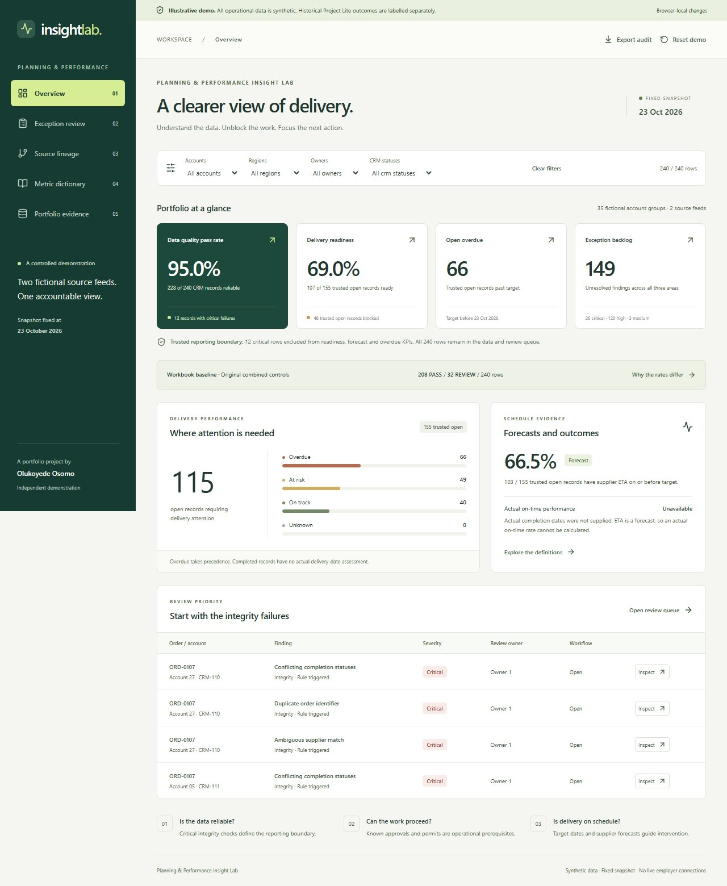
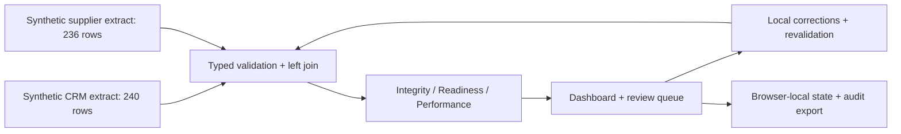

# Planning & Performance Insight Lab

A synthetic portfolio demonstration by Olukoyede Osomo. Consolidate two source extracts, inspect data-integrity failures, distinguish operational blockers from delivery risks, and complete an accountable reviewer workflow.

[Open the live demonstration](https://planning-performance-insight-lab.vercel.app/)

Validated with 45 automated tests, 10 end-to-end browser checks and eight rendered accessibility states. All operational data is fictional.



## Run locally

Requires Node.js 22.12+ (tested on Node 24) and npm.

```sh
npm install
npm run dev
npm test
npm run build
npm run qa
npm run verify
```

Open the localhost URL printed by the server. **`npm run dev` builds the app and serves the validated production bundle locally**, avoiding the hot-reload optimizer's peak memory use on the test workstation. Re-run it after source edits. `npm run dev:vite` offers conventional Vite hot reload on a workstation with sufficient free memory. `npm run preview` serves an existing build without rebuilding. A lockfile records installed versions. The tool launcher bounds native compiler concurrency and local preview heap use.

## What to explore

- **Overview:** independent integrity, readiness and delivery indicators, population filters, trusted-row exclusions, forecast adherence and the original workbook comparison.
- **Exception review:** search, filter, sort, inspect every source match, assign a reviewer, record evidence, correct a local source, revalidate, resolve and reopen.
- **Source lineage:** source-to-KPI path, join assumptions, row counts, missing and ambiguous joins.
- **Metric dictionary:** calculations, controls, decisions, limitations and cadence.
- **Portfolio evidence:** historical Project Lite experience separated from this fictional implementation.

The snapshot is fixed at **23 October 2026**. Human-action audit timestamps use the actual action time. No actual completion dates were supplied, so actual on-time performance is explicitly unavailable. Forecast adherence is separately labelled.

## Data and parity

The committed fixture preserves **240 CRM rows / 236 supplier rows / 35 fictional accounts** extracted from the supplied workbook. Original Excel combined controls reproduce **208 PASS / 32 REVIEW**, 69 overdue rows and 92 escalation rows. The new integrity-only definition independently yields **228 passing / 12 failing** rows. These are different definitions, not conflicting historical results.

See [the reconciliation](docs/workbook-parity.md), [metrics](docs/metrics.md), [lineage](docs/source-lineage.md), [implementation plan](docs/implementation-plan.md), [decisions](docs/decisions.md), [validation output](docs/fixture-validation.json), [privacy](docs/privacy.md) and [demo walkthrough](docs/demo-walkthrough.md).

## Reviewer workflow

1. Open an integrity finding and compare the source values.
2. Enter a simulated reviewer, assignee and reason. Save **In Review**.
3. Document a root cause, corrective action and evidence.
4. Expand the local source editor, correct values, then **Save correction & revalidate**.
5. Save **Ready for Validation**, then **Revalidate & resolve**. A rule still triggering cannot be closed.
6. Inspect the audit history. Source recurrence automatically reopens a resolved finding. Manual reopening is available with a reviewer and reason.

**Accepted Exception** documents a limitation. It does not change the source-derived indicators and remains in unresolved backlog. Acknowledging a known operational blocker does not imply a data correction.

Changes persist in localStorage for the current browser profile. Separate browsers/profiles have separate demonstrations. Tabs in one profile intentionally share the same storage namespace; concurrent tabs are not a collaboration system. No state is sent to a backend. Export the audit before resetting if needed.

## Architecture



React 19 + TypeScript + Vite, Zod, Vitest and React Testing Library. Pure functions own calculations and the review state machine. Charts use labelled HTML bars with visible counts. Vercel serves static assets; no backend, credentials or environment variables are required.

## Release and limitations

This repository is connected to the `planning-performance-insight-lab` Vercel project. Production deployments use the `main` branch. The committed configuration installs the lockfile with `npm ci`, then runs `npm run verify`: all automated tests, fixture QA, TypeScript checking and the production build must pass before Vercel can publish the new version. A failed command stops deployment and keeps the existing production version live. Pull-request branches receive preview deployments with the same validation. No deployment tokens or GitHub Actions secrets are required. Run `npm run verify` locally before pushing.

`vercel.json` defines this mandatory build gate, static output and security headers. The build also preserves the public `/evidence/` screenshot and architecture URLs. Production must remain synthetic. The original private PDF, workbook and Notion URL are not bundled into the public app.

This is an illustrative local workflow, not authenticated multi-user governance. Audit logs can be edited or erased by the visitor and are not tamper-proof. Browser-storage quotas can limit long sessions; failures display a warning and audit export remains available. No production employer integrations, Power BI or Power Automate deployments are claimed. n8n is omitted because there is no meaningful external refresh or notification flow in this scope.
