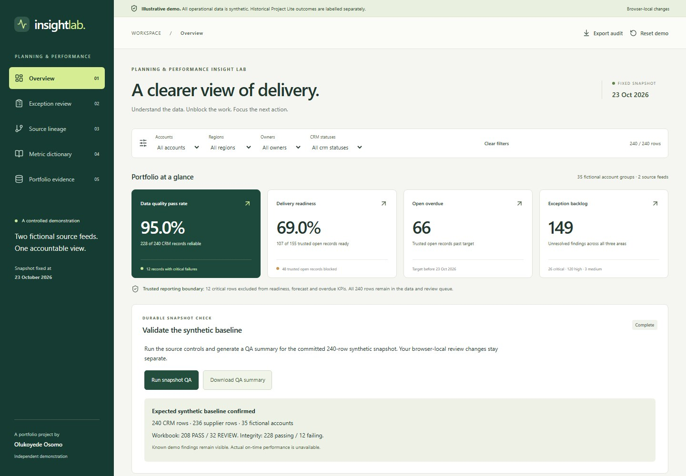

# Synthetic snapshot QA workflow

The first durable workflow is `validateSyntheticSnapshot` in `workflows/validate-synthetic-snapshot.ts`. It uses Workflow SDK 5, Nitro and the Vite integration. The installed `workflow-init` skill detected that the SDK was already present, so implementation followed the versioned guide bundled in `node_modules/workflow/docs/getting-started/vite.mdx`. Use `/workflow` for ongoing development.

## What it does

1. Load the committed synthetic fixture in a durable step.
2. Assess schema validity, joins, independent indicators and original workbook controls in a durable step.
3. Produce a QA summary and explicit baseline checks in a durable step.

Expected population: 240 CRM rows, 236 supplier rows and 35 fictional accounts. Original workbook controls: 208 PASS / 32 REVIEW, 69 overdue and 92 escalation. Independent integrity: 228 passing / 12 failing rows. These findings are intentional examples. `baselineMatches: true` means the expected fixture and controls agree; it does not mean every record is reliable.

The workflow accepts no user records, reviewer identities or browser-local corrections. Its stored data and downloadable summary are synthetic. The UI remembers the most recent run ID in tab-local session storage so status can reconnect after a reload.

## Run locally

```sh
npm ci
npm run dev
```

The default command builds the app and Nitro server and serves them on `http://127.0.0.1:5173`. On Overview, select **Run snapshot QA**. After completion, select **Download QA summary**.

To trigger the same compiled workflow from a terminal:

```sh
curl -X POST http://127.0.0.1:5173/api/qa-runs -H "Content-Type: application/json" -d '{}'
curl http://127.0.0.1:5173/api/qa-runs/REPLACE_WITH_RUN_ID
```

POST returns HTTP 202 with a generated run ID. GET returns `pending`, `running`, `completed`, `failed` or `cancelled`; a completed response includes the summary. The endpoints disable response caching. Invalid run IDs return 400, absent runs return 404, cross-origin browser triggers return 403, and uploaded records return 400.

Local execution uses the SDK's Local World, persisted in `.workflow-data/` (ignored by Git). To inspect runs:

```sh
npx workflow inspect runs
```

## Validation and deployment

`npm run verify` runs the unit/accessibility tests, fixture QA, type checking and full-stack build. `npm run test:workflow` starts the compiled server, checks API boundaries and static evidence delivery, triggers a real workflow, validates the summary, restarts the server and confirms the result persists. GitHub Actions runs both commands before merging into protected `main`.

Nitro chooses the Vercel preset during deployment and emits Build Output API functions and static assets. The required CI check remains **Tests, fixture QA and build**. Vercel also runs `npm run verify` before publication. No custom secrets or external source systems are used. Vercel-managed workflow storage and queues are distinct from the browser-local reviewer demonstration.

## Browser verification

Desktop and mobile checks confirmed workflow completion, reload reconnection, valid QA download, no page-level horizontal overflow, zero axe violations and zero runtime errors. See [the browser validation record](workflow-browser-validation.json).


